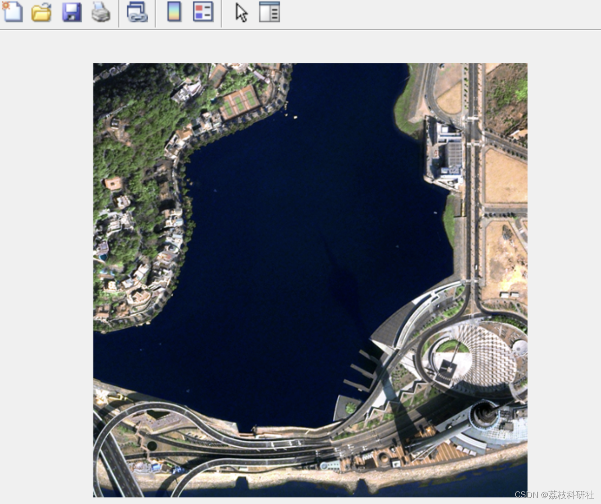
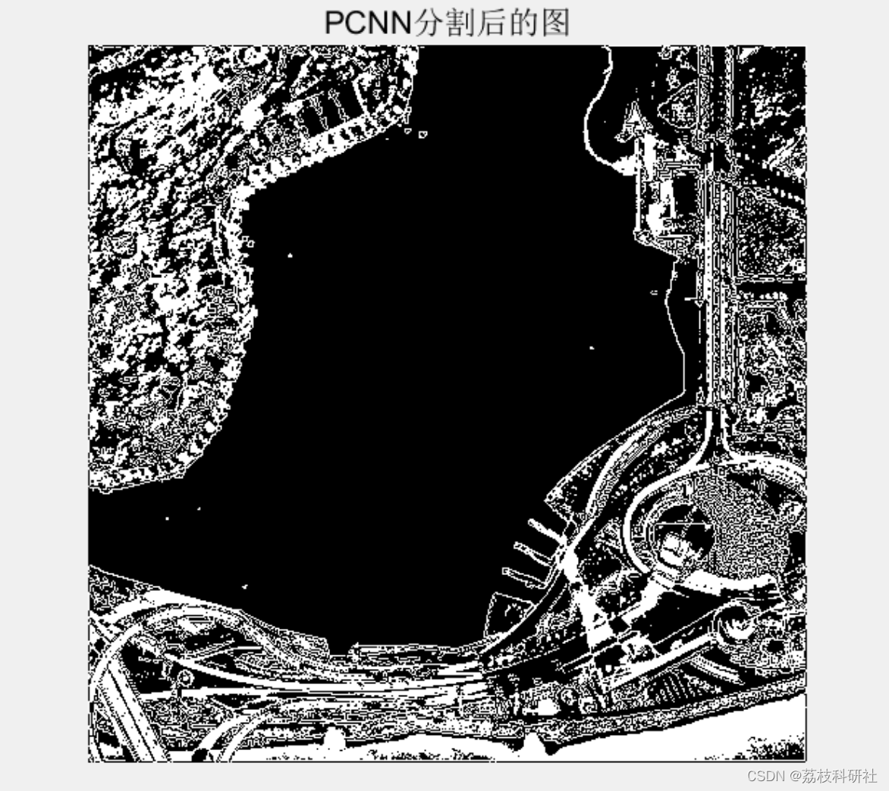

# Optimization of SCA algorithm for image automatic segmentation in pulse coupled neural network (Matlab code implementation)

📚2 Running results editing
Edit:
Part of the code:
%% SCA algorithm optimization for pulse coupled neural network image automatic segmentation
% Reading an image
pcode s.m
clc; clear all; 
close all; 
I = imread('1006.jpg'); 
% Convert the image to grayscale
if(size(I,3)~=1) 
Igray = rgb2gray(I); 
else 
Igray = I; 
end 
% Subplot (1,3,1), display the original image
figure 
imshow(I,[]); 
% Title 'The original image'
% Axis [0,200,0,200]; 
% Axis on;         % Display coordinate system
I1=rgb2gray(I); 
% Subplot (1,3,2), display the grayscale image
% Title 'Grayscale image'
% Axis [0,200,0,200]; 
% Axis on;         % Display coordinate system
% J=imadjust(I1,[0.1 0.5],[]); % Local stretching, stretch the grayscale within [0.1 0.5] to [0 1]
% Subplot (2,2,3), display the transformed image [0.1 0.5]
% Title 'Linearly transform the image[0.1 0.5]'
% Axis [0,200,0,200]; 
% Grid on;         % Display grid lines
% axis on;
K = imadjust(I1, [0.2 0.8], []); % Local stretching, stretch the grayscale within [0.3 0.7] to [0 1]
% subplot(1,3,3),imshow(K);  
% title('Linearly transform the image');  
% axis([0,200,0,200]);  
% grid on;
% axis on;
%% Optimization of SCA algorithm for image automatic segmentation in pulse coupled neural networks
% Reading an image
pcode s.m  
clc;clear all;  
close all;  
I = imread('1006.jpg');  
% Convert the image to grayscale
if(size(I,3)~=1)  
Igray = rgb2gray(I);  
else  
Igray = I;  
end  
% subplot(1,3,1),imshow(I);  
figure  
imshow(I,[]);  
% title('The original image');  
% axis([0,200,0,200]);  
% axis on;
I1=rgb2gray(I);  
% subplot(1,3,2),imshow(I1);  
% title('Grayscale image');  
% axis([0,200,0,200]);  
% axis on;
% J = imadjust(I1, [0.1 0.5], []); % Local stretching, stretch the grayscale within [0.1 0.5] to [0 1]
% subplot(2,2,3), imshow(J); 
% title('Linearly transform the image[0.1 0.5]'); 
% axis([0,200,0,200]); 
% grid on; % Display grid lines
% axis on; % Display coordinate system
K = imadjust(I1, [0.2 0.8], []); % Local stretching, stretch the grayscale within [0.3 0.7] to [0 1]
% subplot(1,3,3), imshow(K); 
% title('Linearly transform the image'); 
% axis([0,200,0,200]); 
% grid on; % Display grid lines
% axis on; % Display coordinate system
% References
% Matlab code implementation

## Images

<!-- PAYMENT_BLOCK -->

## Get this dataset

- Payment link (Stripe): [Buy now](https://buy.stripe.com/3cs8yP7sY87d0vu9AB)
- Payment QR code: 

<!-- /PAYMENT_BLOCK -->
